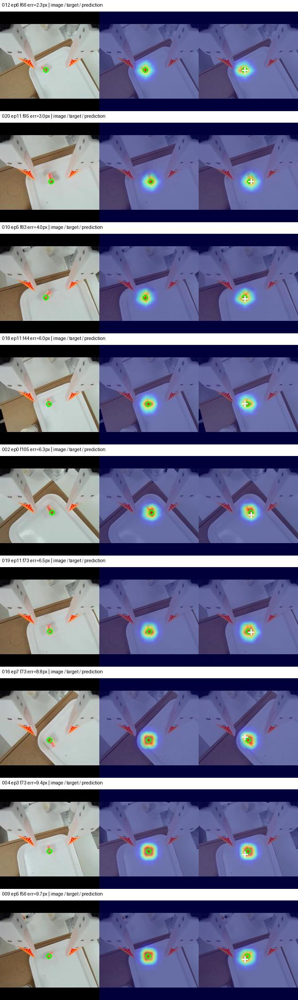

# π0.5 腕部相机空间辅助头

在 xArm7 操作演示中，给 π0.5 增加一个训练目标：从腕部相机的视觉 token 预测目标物体在画面中的位置。下面每组三列依次是腕部原图、弱标签生成的目标热力图、模型预测热力图。



## 模型与权重

本仓库提供 152 条演示训练版本在第 30,000 步导出的 [辅助头权重](weights/spatial_head.pt)。输入是同次微调的 π0.5 主干产生的上下文化前缀特征。前缀依次包含外部相机、左腕相机、被屏蔽的右腕相机和语言 token。每路图像占 256 个 token。辅助头取左腕的第 256–511 号 token，对每个 2048 维特征应用 LayerNorm、Linear(2048,128)、GELU、Linear(128,1)，经 softmax 得到 16×16 空间分布。完整微调策略、原始演示数据和前缀特征需自行准备。

## 查看自己的预测

准备同一帧的前缀张量（torch.save 保存，形状为 [T,2048] 或 [1,T,2048]）和经过模型预处理的 224×224 腕部 RGB 图。使用 Python 3 与 PyTorch 2.4 或更新版本。

```bash
pip install "torch>=2.4" "Pillow>=9.1"
python render_heatmap.py prefix.pt wrist224.png prediction.png
```

## 训练接入与弱标签

[integration.patch](integration.patch) 展示实验所用 RLinf/OpenPI 工作树中的数据加载、模型注册和损失接入。将 spatial_aux.py 放在该工作树的 Python 导入路径，先用 git apply --check 检查补丁与本地版本是否匹配。使用这些改动时应核对相机顺序、视觉 token 数和图像填充方式。

弱标签脚本读取实验格式的 LeRobot 导出目录，包括 meta/info.json、export_manifest.json、动作 Parquet 和腕部视频。在夹爪首次闭合前，从相邻帧中筛选稳定且唯一的粉色连通区域，以质心作为物体位置的近似标签。颜色阈值、图像裁选区域和夹爪动作索引针对本实验设置。

```bash
pip install numpy pyarrow opencv-python
python generate_labels.py dataset_spec.json labels_out
```

dataset_spec.json 的最小输入示例为 `{"datasets":[{"path":"/path/to/export"}]}`。检查 labels_out 下的预览和 labels_proposals.json，再将审核后的 JSON 路径填入训练数据配置的 spatial_labels_path。原始 640×480 坐标映射到 224×168 后上下各填充 28 像素，目标高斯的标准差为 0.75 个网格单元。有效帧贡献空间交叉熵，训练总损失为动作模型损失加 0.01 倍空间损失。

## 离线定位结果

在训练集以外的 7 条有弱标签的新演示中，共取 21 帧。以 224×224 图像上的弱标签质心为参照，预测峰值的平均误差为 **6.12 像素**，固定图像中心为 21.38 像素，取最近网格中心为 6.04 像素。该指标衡量对弱标签的定位精度，真机抓取成功率需另行评估。[完整指标](examples/metrics.json)
